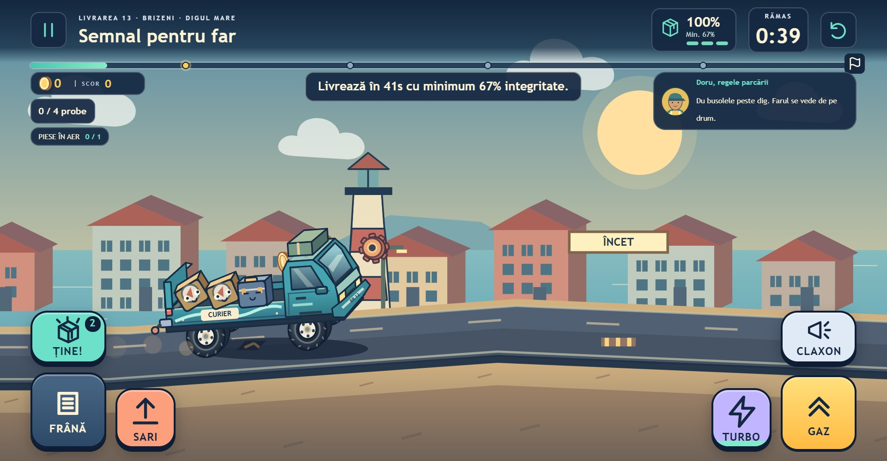
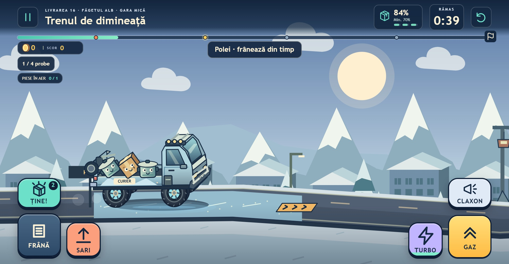
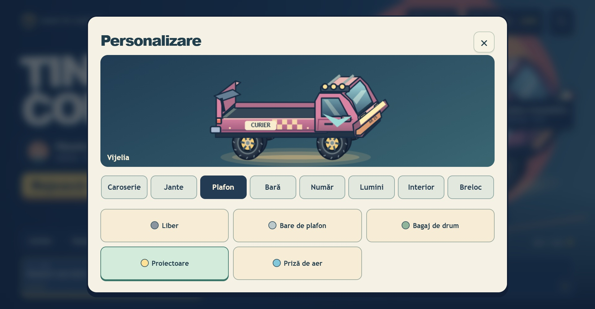

# Ține coletul!

Versiunea 0.13.0. Arcade cu perspectivă 2.5D în română, cu fizica mașinii și a mărfii, 21 de livrări în șase capitole și curse contra cronometru. Offline, fără reclame, conturi, cumpărături cu bani reali sau telemetrie.

## Capturi din joc



| Polei în Făgetul Alb | Personalizarea Vijeliei |
| --- | --- |
|  |  |

## Despre proiect

Am pornit **Ține coletul!** ca proiect de învățare. Am stabilit direcția creativă, am ales ce mecanici, vehicule și trasee să adaug și am ghidat evoluția jocului. Am folosit instrumente de inteligență artificială ca sprijin la implementare și la rafinarea graficii.

Prin acest proiect învăț cum se construiește și se testează un joc pentru Android și cum se pregătește o lansare în Google Play Console. Vreau să aplic experiența asta la următoarele mele jocuri și aplicații.

## Joacă pe PC

Închide fereastra versiunii vechi. Deschide `Joaca-pe-PC.cmd` sau `app/src/main/assets/index.html` în Chrome / Edge. Păstrează întregul director: jocul folosește fișierele locale de lângă HTML.

- Săgeată dreapta / D: accelerație.
- Săgeată stânga / A: frână. În aer, A / D sau cele două pedale înclină mașina.
- Space / W / săgeată sus: săritură de pe sol. Nu poți sări din nou în aer.
- Shift + accelerație: turbo. Pe telefon, ține apăsat Turbo pentru a accelera direct.
- F / butonul Livrează: descarcă marfa după oprirea în zona verde.
- E / butonul ȚINE!: chingă de salvare; două utilizări de câte 2,25 secunde pe livrare.
- H / butonul Claxon: trei sunete comice care alternează, cu o scurtă pauză între apăsări.
- R: reîncepe. Esc / P: pauză și continuare.
- Mouse sau atingere: ține apăsate pedalele de pe ecran.

Oprește în zona verde și apasă F sau Livrează pentru a descărca. Marfa deteriorată sau pierdută scade rezultatul. Rampele și aterizările aduc puncte suplimentare. Monedele, piesele de atelier și bonusurile rare cer o săritură la momentul potrivit. Pe hartă, „Bonusuri în aer” arată locurile unde merită să pregătești săritura. Chinga poate recupera marfa care începe să cadă, până când este declarată pierdută.

**Cartier** deschide carnetul cu replici scrise, ștampile și abțibilduri. În **Setări** poți opri sunetele de joc, realizate în cod.

După o livrare reușită, poți rejuca traseul în **Contra cronometru**. Marfa are un prag de integritate, iar magneții și bulele lipsesc. Recordul de timp și cea mai bună medalie se salvează local. Piesele pentru medalii se acordă când îmbunătățești medalia, iar atelierul le folosește pentru îmbunătățiri fizice. Cutia sport se deschide după petrecerea lui DJ Covrig din livrarea a doua, iar anvelopele de teren după capitolul Cartier.

## Garajul și probele din cabină

În Garaj, alege mașina și deschide „Personalizează mașina” pentru dungi, jante, plafon, bară, număr, lumini sub mașină, interior și breloc. Personalizarea se salvează pentru fiecare mașină. Unele opțiuni cer stele, ștampile sau medalii. În Atelier, piesele câștigate se folosesc la îmbunătățiri.

Pe șase livrări există câte o intrare verde către o probă din cabină. Apasă „Intră în probă” lângă panou, apoi schimbă banda cu butoanele stânga și dreapta. Pe PC funcționează și săgețile de pe tastatură. Proba are propriul timp, iar livrarea se reia de unde ai intrat. Câștigi aur fără lovituri, argint cu una și bronz cu două. Piesele pentru o probă se acordă la prima medalie și când o îmbunătățești. Prima medalie deschide servodirecția în Atelier.

## Orașele noi

După festivalul de pe chei, continuă la Brizeni, Făgetul Alb și Arămia. Fiecare oraș are trei livrări și o probă din cabină. Pe traseele înghețate, Carpatinul și anvelopele de iarnă îmbunătățesc frânarea.

## Dificultatea traseelor

Prima livrare introduce pavajul denivelat. La viteză mare, pragurile zguduie coletele și le reduc integritatea. Frânează din timp și urmărește mesajul „Viteză bună”. La pragurile de șantier poți încetini sau poți sări cu Space / W ori cu butonul **SARI!**.

Bariera este solidă. Oprește lângă linia galbenă, eliberează accelerația și apasă H sau **Claxon** când apare indicația. Din livrarea a treia, la pragurile înalte așteaptă mesajul „Acum sari!”. Accelerează între probe și lasă timp pentru a opri și descărca în zona verde.

| Livrare | Probe | Timp maxim | Starea minimă a mărfii |
| --- | ---: | ---: | ---: |
| Sarmale la pachet | 1 | — | — |
| Chef de cartier | 2 | — | — |
| Pepenii lui Doru | 3 | 34 s | 45% |
| Ședință cu livrare | 4 | 31 s | 55% |
| Vaza de familie | 5 | 32 s | 72% |
| Petrecerea blocului | 8 | 34 s | 75% |
| Marfă pentru târg | 4 | 43 s | 62% |
| Serpentinele din pădure | 5 | 49 s | 66% |
| Vaza de la cabană | 6 | 55 s | 73% |
| Sculele de la depou | 6 | 49 s | 70% |
| Boxe peste viaduct | 7 | 53 s | 73% |
| Livrare pentru festival | 8 | 60 s | 78% |
| Semnal pentru far | 4 | 41 s | 67% |
| Ultima barcă | 5 | 45 s | 70% |
| Start la regată | 7 | 50 s | 74% |
| Trenul de dimineață | 4 | 44 s | 70% |
| Piese la telescaun | 6 | 49 s | 72% |
| Lumină la observator | 7 | 53 s | 76% |
| Răsaduri sub sticlă | 5 | 46 s | 73% |
| Ora exactă | 7 | 52 s | 75% |
| Parada de seară | 8 | 57 s | 78% |

În ultimele patru livrări, trei stele cer o tură fără greșeli la probe, fiecare colet livrat, minimum 94% integritate și un timp mai bun decât limita de livrare.

## Noutăți în 0.5 — Atelier și acrobații

Săritură la comandă, turbo cu energie regenerabilă și control în aer prin pedalele stânga / dreapta. Fiecare traseu are două piese suspendate: urmărește indicatorul SARI și alege momentul săriturii. Covrigii refac puțin din energia turbo. Tura nu se mai încheie automat: oprești, apoi apeși Livrează.

**Atelier**: patru upgrade-uri cu câte trei niveluri — amortizoare, chingi, rezervă turbo și stabilizator. Costurile sunt 55 / 100 / 170 de piese pe nivel. Upgrade-urile merg pe toate mașinile, schimbă mecanicile și adaugă detalii vizuale. Primești piese din livrări, covrigi și piese prinse în aer; nu se cumpără cu bani reali.

**Contracte opționale**, alegi unul înainte de tură:

| Contract | Obiectiv după livrare reușită | Bonus |
| --- | --- | --- |
| Turbo cu covrigi | Minimum 1 secundă turbo și 8 covrigi | 30 piese |
| Curier acrobat | 2 sărituri la comandă și o piesă din aer | 35 piese |
| Marfă de nota zece | Toate obiectele, minimum 94% integritate | 25 piese |

Recompensa se acordă o singură dată la rezultatul turei. Reînceperea înainte de rezultat nu acordă piese. O tură nereușită păstrează doar recompensa mică pentru piesele prinse în aer. Progresul contractului apare în timpul jocului. Din Atelier poți deschide și mașinile, culorile și sunetul.

Salvările vechi primesc o singură dată un credit de 40 de piese pentru fiecare traseu deja terminat. Banii virtuali, upgrade-urile și contractul ales se păstrează local.

## Din 0.4 — Surprizele cartierului

- Magnet de covrigi: atrage covrigii de la distanță timp de 7 secunde.
- Bulă salvatoare: protejează marfa timp de 6 secunde. Dacă un colet ar fi pierdut, îl întoarce în benă și se sparge. Nu consumă chinga.
- Bălți cu stropi, găini animate care reacționează la claxon și petreceri la balcon cu efecte colorate. O trecere lentă pe lângă găini aduce mai multe puncte. Animalele sunt personaje decorative fără coliziuni.
- Claxon pe H sau buton, cu trei sunete sintetizate și bule de text. Pauză de 2,5 secunde între apăsări.
- Album cu 8 abțibilduri originale: covrig, sarmaua turbo, magnet, găină VIP, bulă, pepene, rachetă și coroană. Unul este cadou; celelalte au obiective explicite, fără cumpărături sau recompense aleatorii.
- Alege un abțibild din Cartier pentru a-l vedea pe dubiță. Totalurile se păstrează la finalul fiecărei ture, inclusiv al uneia nereușite. Abandonarea înainte de rezultat nu le salvează.

## Personaje și livrări

Patru personaje originale ilustrate: Tanti Geta, DJ Covrig, Doru, regele parcării, și Domnul Administrator. 56 de replici sintetice în română, cu reacții la pornire, rampă, salvare, marfă pierdută, aterizare și rezultat. Un singur personaj vorbește odată, cu pauze între reacții.

Șase livrări și câte o provocare opțională: Sarmale la pachet, Chef de cartier, Pepenii lui Doru, Ședință cu livrare, Vaza de familie și Petrecerea blocului. Oale și boxe noi în benă. Ștampilele se păstrează; nu sunt obligatorii pentru deblocarea traseelor.

Trei vehicule cu fizică distinctă: Dubița, Bizonul (3 stele), Racheta (7 stele). Culori, recorduri și până la 18 stele. Progresul 0.1 / 0.2 / 0.3 / 0.4 este păstrat în aceeași origine. Schimbarea browserului sau a locației fișierului poate schimba salvarea locală; în APK originea este stabilă.

## APK pentru test Android

Directorul `Curier` trebuie să fie lângă `Play`, unde au fost descărcate uneltele pentru Impostorul. Rulează `Creeaza-APK.cmd`. Scriptul reutilizează JDK, Gradle și Android SDK din `Play/.tools`, rulează testele dacă Node este disponibil, apoi cere lint și compilarea APK debug.

Rezultatul apare ca `artifacts/Tine-coletul-0.9.0-test.apk`.

Dacă uneltele se află în altă parte:

```powershell
.\build-android.ps1 -ToolchainRoot 'C:\cale\catre\Play\.tools'
```

Arhiva conține sursele. APK-ul din buildul debug se folosește pentru testare pe telefon. Vezi `VERIFICARI.md` pentru auditul Android și pașii de verificare ai următoarei versiuni.

Pentru a genera local un AAB de verificare și a rula analiza Android Lint:

```powershell
.\build-android.ps1 -ReleaseCheck
```

Dacă ai mai încărcat un build în Play Console, adaugă `-PreviousVersionCode` urmat de cel mai mare cod folosit. Scriptul oprește buildul dacă noul cod nu îl depășește. Fișierul rezultat are sufixul `-verificare.aab` și trebuie semnat cu cheia de upload a acestui joc înainte de încărcarea în Play Console.

## Dezvoltare

`npm test` rulează 55 de teste pentru fizică, trasee, scor, salvare, provocări, personaje, replici scrise și progres la cronometru, fără instalarea de dependențe npm.

`npm start`: server opțional de previzualizare, doar pe calculatorul tău; Android nu îl folosește. `tools/browser-qa.cjs` verifică interfața cu Playwright și Chrome, inclusiv comenzile tactile și accesul la Contra cronometru.

| Fișier | Rol |
| --- | --- |
| `app/src/main/assets/workshop.js` | Upgrade-uri, contracte, costuri și recompense |
| `app/src/main/assets/fun.js` | Bonusuri, surprize, abțibilduri și desenarea lor |
| `app/src/main/assets/characters.js` | Personaje, replici, portrete |
| `app/src/main/assets/dialogue.js` | Reacțiile scrise ale personajelor |
| `app/src/main/assets/districts.js` | Traseele din Dealuri și Depou |
| `app/src/main/assets/levels.js` | Trasee, povești, provocări, scor |
| `app/src/main/assets/physics.js` | Vehicul, marfă, chingă, livrare |
| `app/src/main/assets/render.js` | Desenare Canvas și efecte |
| `app/src/main/assets/storage.js` | Salvare compatibilă cu versiunile vechi |
| `app/src/main/assets/app.js` | Meniuri, control și bucla jocului |
| `app/src/main/java/ro/vasi/curier/MainActivity.java` | Înveliș Android offline |

DESIGN.md, CONTINUA-DE-AICI.md și VERIFICARI.md descriu stadiul exact. AUDIO-CREDITS.md documentează efectele sonore. Matter.js 0.20.0 este inclus local, cu MIT în vendor/MATTER-LICENSE.txt.
